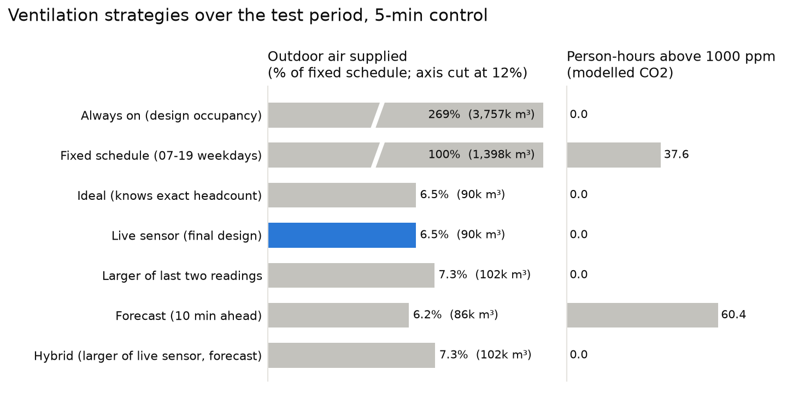

# Occupancy-Based Ventilation for Room G.20, Building 60 at Monash University

Individual project for **MMA3001: Numerical Methods and Machine Learning** (Monash University), using **Dataset 2: Monash Smart Infrastructure Occupancy and Environmental Data**.

## Engineering problem

**Context.** HVAC systems ventilate rooms to dilute the CO2, moisture and odours that occupants produce. AS 1668.2 sets the minimum outdoor-air rate per person, so the air a room needs rises with the number of people in it. For laboratory work, which G.20 represents, this project uses 10 L/s per person. Heating and cooling can take 30 to 75 minutes to reach a target temperature, but ventilation can respond within 5 to 10 minutes, so it can follow occupancy if occupancy is known.

**Problem.** Conventional constant-air-volume (CAV) systems ventilate for peak occupancy all the time, which wastes energy when a room is not full. Variable-air-volume (VAV) systems vary with air-conditioning demand but are blind to occupancy. Demand-controlled ventilation (DCV) uses CO2 sensors, which are costly and need upkeep. Building 60's CO2 sensors in this dataset show the risk: three are frozen, one ran for only four months, and one reads CO2 falling during the day.

**Problem statement.** Can live headcount sensors combined with short-term occupancy forecasting provide DCV without relying on high-maintenance and often unreliable CO2 sensors?

**Intended use.** A controller sets G.20's outdoor air every 5 minutes from the live headcount (10 L/s per measured person). If the people counter fails, it supplies full design air whenever the room is usually in use. Building managers also get an estimate of the air, and so energy, saved compared with constant or scheduled ventilation.

**Scope.**
- One room (G.20) with 5-minute control. 10-minute, 30-minute and 1-hour control, and forecast horizons up to 1 hour, are compared.
- The room is about 300 m² with a 2.7 m ceiling (810 m³), a student estimate.
- The design occupancy is 42 people: the 99.9th percentile of the measured headcount over occupied time in the training period.
- The dataset has no CO2 measurements for G.20, so every CO2 value is modelled from the measured headcount.
- There is no HVAC plant data, so energy is represented by the outdoor air supplied.

## Key results (test period 1 Jan – 22 Apr 2026, 5-min control)



| Strategy | Outdoor air (m³) | Person-hours above 1000 ppm (modelled) |
|---|---|---|
| Always on, 42 people | 3,757,000 | 0 |
| Fixed schedule, 42 people, weekdays 07:00–19:00 | 1,398,000 | 37.6 |
| Ideal: knows the exact headcount | 90,000 | 0 |
| **Live sensor, previous 5-min headcount (final design)** | **90,000** | **0** |
| Larger of the last two readings | 102,000 | 0 |
| Forecast only, 10 min ahead | 86,000 | 60.4 |
| Hybrid: larger of live sensor and forecast | 102,000 | 0 |

- **Live-sensor control uses 6.5% of the fixed schedule's air (2.4% of always on) with no modelled time above the limit.** The fixed schedule exceeds the limit when people stay after its 19:00 switch-off.
- **The forecast adds nothing.** Ten minutes ahead the room is usually as it was, so "same as now" is the most accurate forecast (MAE 0.362 people; gradient boosting 0.399).
- **Sensor-failure fallback.** A failed counter looks like an empty room. With the counter failed for the whole test period, the fallback gives 0 person-hours above the limit, against 148 with no fallback. At the historical outage rate (0.9% of the time) it adds about 22% to the air used.

How the design got here is recorded in the [decision log](reports/decision_log.md).


## Inputs and outputs

| | Item | Format, units, domain |
|---|---|---|
| Input | Occupancy events (people counters) | CSV: `floorspaceid`, `occupancystatus`, `headcount` (integer ≥ 0), `collecteddate` (timestamp with UTC offset) |
| Input | Semester periods; public holidays | `data/calendar/*.csv` (dates, inclusive) |
| Input | Room and air parameters | 300 m², 2.7 m (810 m³); 10 L/s per person (AS 1668.2); design occupancy 42; CO2 generation 0.0052 L/s per person; outdoor CO2 420 ppm; infiltration 0.3 air changes per hour; limit 1000 ppm |
| Output | Occupancy table | One row per interval (2 min to 1 h): mean headcount, time occupied, data-quality flags |
| Output | Forecast headcount | People expected in G.20 ten minutes ahead, per 5-min interval |
| Output | Ventilation assessment | Per strategy: outdoor air supplied (m³) and modelled time above 1000 ppm (person-hours) |

Invalid inputs are rejected with clear errors: timestamps without a time zone, missing columns, negative headcounts or airflows, resolutions that do not divide an hour, and overlapping calendar periods. Function-level inputs and outputs are in the [HTML documentation](docs/smart_infra.html).

## Repository structure

```
.
├── src/smart_infra/            # installable package (all reusable code, with docstrings)
│   ├── occupancy.py            # events -> clean interval table (held state, exact integration)
│   ├── academic_calendar.py    # semester periods and public holidays as model inputs
│   ├── forecasting.py          # leak-free inputs, baselines, models, tuning, metrics
│   └── ventilation.py          # airflow demand, design occupancy, fallback, CO2 mass balance
├── scripts/                    # reproducible pipeline steps (run in the order below)
├── tests/                      # pytest suite (synthetic data with known answers)
├── data/
│   ├── calendar/               # calendar inputs with sources (tracked)
│   └── README.md               # where to put the raw data (not tracked)
├── reports/                    # generated results, figures, test report
├── docs/                       # generated HTML API documentation (pdoc)
├── pyproject.toml, requirements.txt, LICENSE
```

## Reproducing the results

```bash
python -m venv .venv
.venv\Scripts\activate            # macOS/Linux: source .venv/bin/activate
pip install -r requirements.txt
pip install -e .
```

Place the raw dataset as described in [`data/README.md`](data/README.md), then run from the repository root:

| Step | Command | Output | Time |
|---|---|---|---|
| 1. Audit the raw data | `python scripts/profile_raw_data.py` | [`reports/data_audit_findings.md`](reports/data_audit_findings.md) | ~1 min |
| 2. Build occupancy tables | `python scripts/build_occupancy_tables.py` | `data/processed/g20_*.csv`, [`reports/g20_occupancy_summary.md`](reports/g20_occupancy_summary.md) | ~15 s |
| 3. Resolution convergence | `python scripts/resolution_convergence.py` | [`reports/resolution_convergence.csv`](reports/resolution_convergence.csv), figure | ~1 min |
| 4. Forecasts | `python scripts/run_forecast.py` | [`reports/forecast_results.md`](reports/forecast_results.md) | ~2 min |
| 5. Ventilation strategies | `python scripts/ventilation_study.py` | [`reports/ventilation_results.md`](reports/ventilation_results.md), figures | ~1 min |
| 6. Forecast horizons | `python scripts/horizon_comparison.py` | [`reports/horizon_comparison.md`](reports/horizon_comparison.md) | ~1 min |
| 7. Sensitivity analysis | `python scripts/sensitivity.py` | [`reports/sensitivity.md`](reports/sensitivity.md) | ~3 min |
| 8. Performance | `python scripts/benchmark.py` | [`reports/performance.md`](reports/performance.md) | ~30 s |

**Tests and documentation**

```bash
pytest --html=reports/test_report.html --self-contained-html
pdoc smart_infra --output-dir docs -d numpy
```

The tests use small synthetic datasets with known answers, so they run without the raw data.

## Method

**Data cleaning.** The export is an event stream: reports arrive about every 2 s while someone is present and stop when the room is empty. Suspect data is flagged, not deleted.

| Rule | What | Action | G.20 (5 min) |
|---|---|---|---|
| `OCC-RANGE-01` | Missing or negative headcount | Remove row | 0 |
| `OCC-DUP-01` / `-02` | Duplicate rows / conflicting rows at one timestamp | Remove / keep latest | 1 / 3 rows |
| `OCC-CAP-01` | Headcount above capacity (200 people: 300 m² at 1.5 m² per person; highest reading 72) | Cap and flag | 0 intervals |
| `OCC-GAP-01` | Silence over 24 h covering weekday working hours | Flag as outage; exclude | 5 periods |
| `OCC-NIGHT-01` | Detections 01:00–05:00 | Flag; tested in sensitivity analysis | 1,578 intervals |

**Occupancy series.** Each report's headcount holds until the next report, for at most 5 minutes. Person-time in each interval is integrated exactly with a cumulative sum and binary search. As a check, the mean headcount (0.876 people) is identical at every resolution.

**Resolution.** Labelling an interval occupied only when a report lands in it does not converge as intervals shrink (13% at 10 s against a true 29.4%). The held-state labels converge to 29.4%. 5-minute control was chosen from the room's air dynamics (time constant about 30 minutes at design occupancy): 5- and 10-minute control have no time above the limit, while 30-minute and 1-hour control do.


**Forecasting.** Issued 10 minutes ahead, using only what is known then: calendar inputs and finished headcounts (latest, last hour, same time yesterday and last week). Models: time-of-week and persistence baselines, ridge regression, gradient boosting, and gradient boosting on calendar inputs only. Gradient-boosting settings were tuned by time-series cross-validation on training data. Early stopping is off because it made results irreproducible.

**CO2.** A well-mixed mass balance, V dC/dt = G·N + Q·(C_out − C), solved exactly within each 1-minute step. Explicit Euler is implemented for comparison: its error grows with the step and it is unstable when Q·Δt/V > 2.

**Fallback.** While the counter is known to have failed, supply design air (420 L/s) whenever the room's average headcount for that time of week exceeds 0.25 people (chosen on 2025 data). It is deliberately safe rather than efficient.

## Validation

- **Withheld test data:** trained on March 2024 – December 2025, tested once on 1 January – 22 April 2026.
- **No tuning on test data:** model settings were chosen within training data; the safety margin (0%) and fallback threshold were chosen on 2025 data.
- **Engineering validation:** each strategy is compared with an ideal controller that knows the exact headcount. The fallback is tested with the counter failed for the whole test period.
- **Verification:** 51 unit tests with known answers, including the analytical CO2 solution, Euler's convergence and stability limit, leak-free forecast inputs, and person-time being identical at every resolution.
- **Metrics:** forecast MAE and RMSE in people and share under-forecast; outdoor air (m³) and person-hours above 1000 ppm.
- **What it cannot establish:** the CO2 model is not checked against measurements (G.20's CO2 sensors are missing from the extract); the test period covers only summer and the start of semester 1; the baselines are assumed, not G.20's actual HVAC operation.

## Limitations

- CO2 is simulated: the well-mixed model, outdoor CO2, generation rate and infiltration are assumptions ([sensitivity analysis](reports/sensitivity.md)).
- Room size is an estimate and counter accuracy is unknown; the finding that no margin is needed depends on the room size.
- A failed counter looks like an empty room, so the fallback needs a second sensor or a health check to know when to act. The extract merges G.20's two counters.
- One room and one test period; G.25 could test whether the method generalises.

## AI use

AI assistance (Claude) was used for code, analysis scripts, documentation and report drafting under the student's direction. Every result is produced by a script in this repository and checked by tests. The engineering problem, the ventilation framing, the room parameters and the methodological decisions were the student's. The full AI-use reflection is in the written report.

## License

Source code is released under the [MIT License](LICENSE). The dataset is supplied by Monash University for MMA3001 coursework and is governed by the unit's data usage terms.
