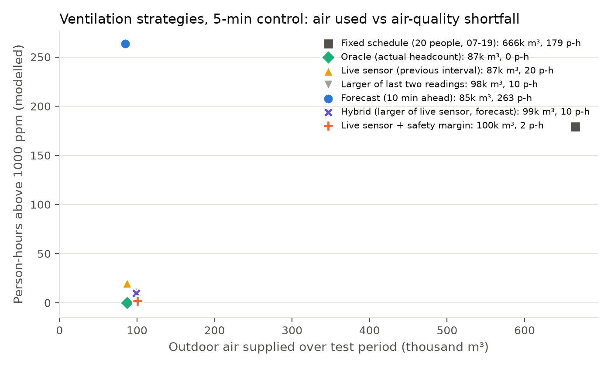
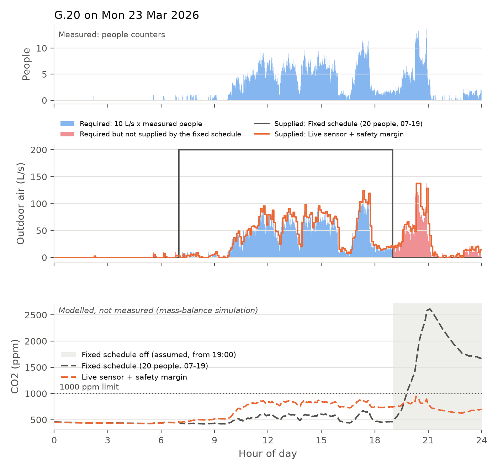
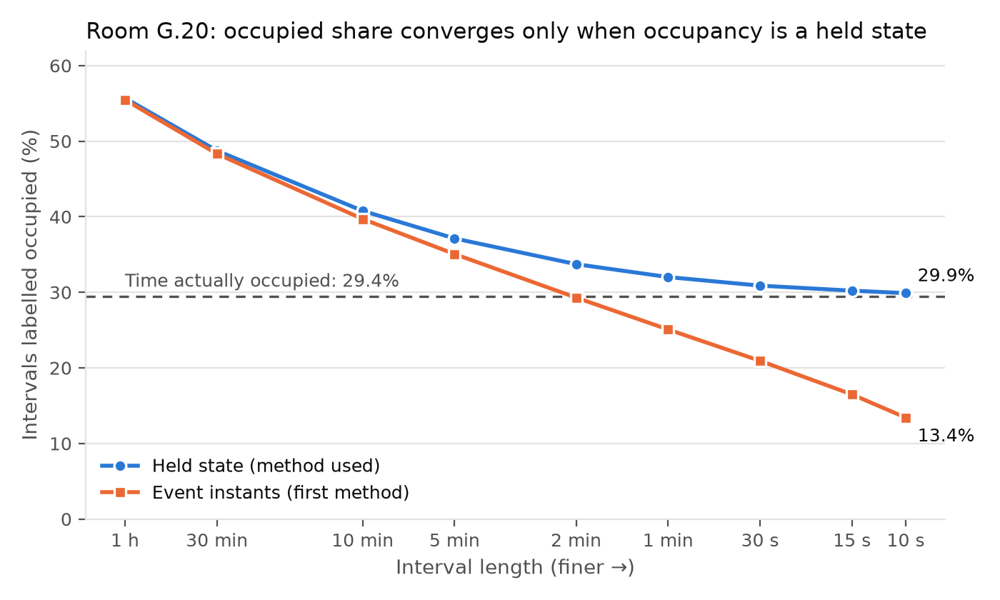

# Occupancy-Based Ventilation for a Monash Workshop Room

Individual project for **MMA3001: Numerical Methods and Machine Learning** (Monash University), using **Dataset 2: Monash Smart Infrastructure Occupancy and Environmental Data**.

**Question:** how much outdoor air does room G.20 (Building 60, Monash Clayton) need, interval by interval, and can it be supplied from occupancy data instead of a fixed schedule, without letting CO2 build up?

The project turns 1.9 million people-counter events into a clean 5-minute occupancy series, converts headcount into outdoor-air demand (10 L/s per person), tests whether a headcount forecast 10 minutes ahead improves control, and models the room's CO2 under each ventilation strategy over a withheld test period. No CO2 was measured in G.20, so every CO2 value is modelled from the measured headcount.

## Key results (test period 1 Jan – 22 Apr 2026, 5-min control)

| Strategy | Outdoor air vs fixed schedule | Person-hours above 1000 ppm CO2 (modelled) |
|---|---|---|
| Fixed schedule (sized for 20 people, Mon–Fri 07:00–19:00) | 100% | 179 |
| Live sensor (previous 5-min headcount) | 13.1% | 19.9 |
| Larger of the last two readings (no forecast) | 14.8% | 10.1 |
| Forecast alone (10 min ahead) | 12.8% | 263.5 |
| Hybrid (larger of live sensor and forecast) | 14.8% | 9.8 |
| **Live sensor + 15% safety margin (final design)** | **15.1%** | **1.6** |



- **Occupancy-based ventilation needs about 85% less outdoor air than the fixed schedule and breaches the CO2 limit far less**, because the fixed schedule both over-ventilates a room that is empty 71% of the time and switches off while people are still there in the evening.
- **Ten minutes ahead, the forecast adds nothing that a safety margin does not.** The persistence baseline ("same as now") is the most accurate forecast (MAE 0.349 people; gradient boosting 0.366). The hybrid's improvement over the live sensor comes from supplying a little more air: the larger of the last two readings matches it with no model, and a 15% margin beats it.
- **The safety margin was chosen before the test period** (on 2025): the smallest margin that cut person-hours above the limit by at least 90%. At exactly 10 L/s per person the room settles at 940 ppm, just under 1000 ppm, so some margin is needed ([sensitivity analysis](reports/sensitivity.md)).
- **Control resolution matters.** Live-sensor control gives 20 person-hours above the limit at 5-min control, 90 at 10 min, 421 at 30 min and 755 at 1 h. Longer forecast horizons only add air ([horizon comparison](reports/horizon_comparison.md)).



## Inputs and outputs

| | Item | Format, units, domain |
|---|---|---|
| Input | Raw occupancy events (export from the people counters) | CSV: `floorspaceid`, `occupancystatus`, `headcount` (integer ≥ 0), `collecteddate` (timestamp with UTC offset) |
| Input | Monash semester periods; Victorian public holidays | `data/calendar/*.csv` (dates, inclusive) |
| Input | Room and ventilation parameters | Area 30 m² (student's estimate), height 2.7 m, 10 L/s per person (AS 1668.2, office use), CO2 generation 0.0052 L/s per person, outdoor CO2 420 ppm, infiltration 0.3 air changes per hour |
| Output | Occupancy tables | One row per interval (2 min to 1 h): mean and peak headcount, occupied fraction, quality flags |
| Output | Headcount forecast | People (≥ 0) per 5-min interval, 10 min ahead; mean and 90th percentile |
| Output | Ventilation assessment | Outdoor air supplied (m³), modelled CO2 (ppm), person-hours above the limit, per strategy |

Invalid inputs are rejected with clear errors (timestamps without a timezone, missing columns, negative headcounts or airflows, resolutions that don't divide an hour, overlapping calendar periods). Suspect data is flagged, not deleted (see [cleaning rules](#data-cleaning)).

## Repository structure

```
.
├── src/smart_infra/            # installable package (all reusable code, with docstrings)
│   ├── occupancy.py            # events -> clean interval table (held state, exact integration)
│   ├── academic_calendar.py    # semester periods and public holidays as model inputs
│   ├── forecasting.py          # leak-free inputs, baselines, models, tuning, metrics
│   └── ventilation.py          # airflow demand, CO2 mass balance (exact and Euler)
├── scripts/                    # reproducible pipeline steps (run in the order below)
├── tests/                      # pytest suite (synthetic data with known answers)
├── data/
│   ├── calendar/               # calendar inputs with sources (tracked)
│   └── README.md               # where to put the raw data (not tracked)
├── reports/                    # generated results, figures, test report
├── docs/                       # generated HTML API documentation (pdoc)
├── pyproject.toml, requirements.txt, LICENSE
```

## Reproducing the results

```bash
python -m venv .venv
.venv\Scripts\activate            # macOS/Linux: source .venv/bin/activate
pip install -r requirements.txt
pip install -e .
```

Place the raw dataset as described in [`data/README.md`](data/README.md), then run from the repository root:

| Step | Command | Output | Time |
|---|---|---|---|
| 1. Audit the raw data | `python scripts/profile_raw_data.py` | figures in [`reports/data_audit_findings.md`](reports/data_audit_findings.md) | ~1 min |
| 2. Build occupancy tables | `python scripts/build_occupancy_tables.py` | `data/processed/g20_*.csv`, [`reports/g20_occupancy_summary.md`](reports/g20_occupancy_summary.md) | ~15 s |
| 3. Resolution convergence study | `python scripts/resolution_convergence.py` | [`reports/resolution_convergence.csv`](reports/resolution_convergence.csv), figure | ~1 min |
| 4. Train and test forecasts | `python scripts/run_forecast.py` | [`reports/forecast_results.md`](reports/forecast_results.md) | ~2 min |
| 5. Ventilation strategies | `python scripts/ventilation_study.py` | [`reports/ventilation_results.md`](reports/ventilation_results.md), figures | ~1 min |
| 6. Forecast horizon comparison | `python scripts/horizon_comparison.py` | [`reports/horizon_comparison.md`](reports/horizon_comparison.md) | ~1 min |
| 7. Sensitivity analysis | `python scripts/sensitivity.py` | [`reports/sensitivity.md`](reports/sensitivity.md) | ~3 min |
| 8. Performance study | `python scripts/benchmark.py` | [`reports/performance.md`](reports/performance.md) | ~30 s |

Run the scripts from the repository root after `pip install -e .` (or set `PYTHONPATH=src`).

**Tests and documentation**

```bash
pytest --html=reports/test_report.html --self-contained-html
pdoc smart_infra --output-dir docs -d numpy
```

The tests use small synthetic datasets with known answers, so they run without the raw data. The HTML documentation is at `docs/smart_infra.html`.

## Method

### Data cleaning

The occupancy export is an event stream: reports arrive about every 2 s while someone is present and stop when the room is empty, so a sensor outage looks like an empty room. Each rule has an ID; suspect data is flagged so each rule can be switched off for the sensitivity analysis.

| Rule | What | Action | G.20 (5 min) |
|---|---|---|---|
| `OCC-RANGE-01` | Missing or negative headcount | Remove row | 0 |
| `OCC-DUP-01` / `-02` | Duplicate rows / conflicting rows at one timestamp | Remove / keep latest | 1 / 3 rows |
| `OCC-CAP-01` | Headcount above room capacity (20 = 30 m² at 1.5 m² per person; readings reach 72) | Cap at 20, flag | 825 intervals |
| `OCC-GAP-01` | Silence > 24 h covering weekday working hours | Flag as outage, exclude | 5 periods |
| `OCC-NIGHT-01` | Detections 01:00–05:00 | Flag, test in sensitivity | 1,578 intervals |

### Occupancy as a held state, and the resolution convergence study

Each report's headcount is held until the next report, for at most 5 minutes (99.9% of gaps between reports during occupied spells are shorter). Occupied time and person-time in every interval are then integrated **exactly** with a cumulative sum and binary search, which is 70–80 times faster than a loop and verified against it ([performance](reports/performance.md)).

A convergence study across nine resolutions showed why the held state is needed: labelling an interval occupied only when a report lands in it does not converge as intervals shrink, and falls to 13% at 10 s against a true 29.4%. With the held state, the share of intervals occupied converges from above to the time-weighted value, and the time-weighted measures (29.4% of time occupied, 0.853 people on average) are identical at every resolution.



**Choice of resolution: 5 min.** For the yes/no label, convergence alone would need about 15 s, which no ventilation system can act on. The ventilation target, average headcount, is exact at any resolution, so the choice follows the physics: the room's air time constant (volume / airflow) is about 20–25 minutes, and 5-minute control resolves it while staying within what fans can follow. The ventilation results confirm this.

### Forecasting

The forecast for an interval is issued 10 minutes ahead (enough to cover the 5-minute delay of the live reading and the ventilation system's response) and uses only what is known then: calendar inputs (time of day, day of week, semester period, public holiday) and headcounts from intervals already finished (latest, last hour, same time yesterday and last week). A test checks that no input can see the future.

| Model | Role |
|---|---|
| Time-of-week average | Baseline: typical headcount for that weekday and time |
| Persistence | Baseline: the latest known headcount |
| Ridge regression | Linear model on calendar and recent-headcount inputs |
| Gradient boosting | Trees, which capture interactions; settings tuned by time-series cross-validation on training data only |
| Gradient boosting, calendar only | What can be forecast a day or more ahead |
| Gradient boosting, 90th percentile | Errs high, because under-ventilating is worse than over-ventilating |

### Ventilation and CO2

Required outdoor air = 10 L/s × people. Indoor CO2 follows a well-mixed mass balance, V dC/dt = G·N + Q·(C_out − C), solved **exactly** within each 1-minute step (inputs are constant within a step). The explicit Euler method is implemented for comparison: its error grows linearly with the step and it becomes unstable when Q·dt/V > 2, while the exact solution has neither problem ([performance](reports/performance.md)).

## Validation

- **Chronological split:** trained on March 2024 – December 2025, tested on 1 January – 22 April 2026, data the models never saw. A random split would leak future information.
- **Metrics:** mean absolute error and RMSE in people, bias, share of intervals under-forecast, pinball loss for the 90th percentile (which is under-forecast in 7% of intervals, close to its 10% target).
- **Engineering validation:** outdoor air supplied and person-hours above 1000 ppm for each strategy, against an oracle that knows the true headcount and against simple strategies with no forecast. The safety margin was chosen on 2025, before the test period.
- **Verification:** 48 unit tests, including an analytical CO2 solution, Euler's first-order convergence and stability limit, leak-free forecast inputs, and invariants (person-time identical at every resolution).
- **What validation cannot establish:** no CO2 data exists for G.20 in the extract (its listed sensors are missing), so the modelled CO2 is not checked against measurements. The fixed schedule is an assumed comparison, not G.20's actual HVAC schedule. The test period covers summer break and the start of semester 1 only.

## Limitations

- Room area (30 m²) is a rough estimate and the people-counter accuracy is unknown; readings above room capacity show the sensors sometimes overcount or count people outside the room.
- The CO2 model assumes a well-mixed room and constant outdoor CO2, and the infiltration rate is assumed.
- An empty room and a sensor outage both produce no data; long weekday silences are excluded, but shorter outages are counted as empty.
- Calendar dates were compiled from official pages via search results ([sources](data/calendar/README.md)).
- One room only; G.25 could test whether the method generalises.

## AI use

AI assistance (Claude) was used for code, analysis scripts, documentation and report drafting under the student's direction. Every result is produced by a script in this repository and checked by tests. The choice of engineering problem, the ventilation framing, the room parameters and all methodological decisions were the student's. The full AI-use reflection is in the written report.

## License

Source code is released under the [MIT License](LICENSE). The dataset is supplied by Monash University for MMA3001 coursework and is governed by the unit's data usage terms.
